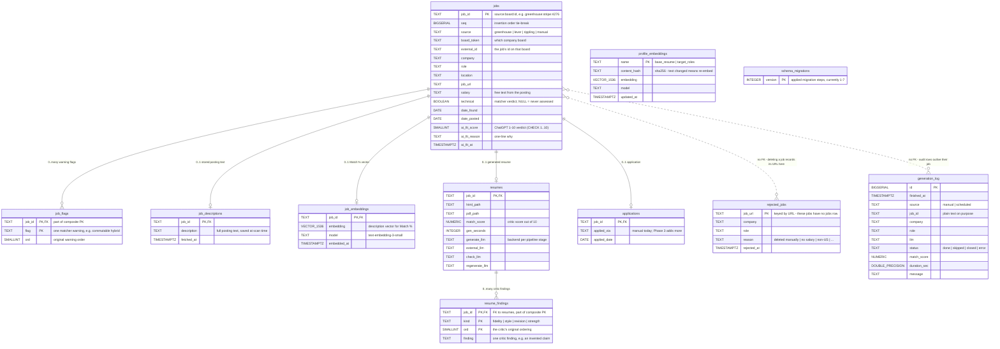

# Database Architecture

The app stores everything in one PostgreSQL database (`resume_handler`, running in
Docker with the pgvector extension). The design is a **hub and spokes**: one central
`jobs` table holds every job you're tracking, and small child tables hang off it, each
answering one question about that job. Three standalone tables sit outside the hub —
including the **rejection memory** that remembers jobs you deleted or that failed the
filters, so scans never pull them again.

## The diagram

Paste this into any Mermaid-aware tool (mermaid.live, GitHub, Notion, IntelliJ's
Markdown preview) to see it rendered.

## How to read it

**`jobs` is the hub.** One row per job you're tracking. Its primary key packs the
job's identity (`greenhouse:stripe:4276`), and the same identity also lives in three
real columns (`source` / `board_token` / `external_id`) with a CHECK constraint
guaranteeing the two forms can never disagree. The ChatGPT fit verdict
(`ai_fit_score`, 1–10, plus a one-line reason) lives directly on this table.

**The six spokes** all use the job's id as their own primary key (so each is strictly
0-or-1 per job, except `job_flags` and `resume_findings` which are 0-to-many), and all
say `ON DELETE CASCADE` — delete a job and every spoke row vanishes with it:

- **`job_flags`** — matcher warnings ("commutable hybrid", "visa unclear"), one per row.
- **`job_descriptions`** — the full posting text, saved the moment the scan fetches it.
  This is why scoring and resume generation never need to re-download a posting.
- **`job_embeddings`** — the description's AI vector, used for the Match % column
  (cosine similarity against your résumé's vector, computed in SQL). A separate table
  so the ~6 KB vectors stay out of ordinary page loads.
- **`resumes`** — row exists = a resume was generated. File paths, the critic's score,
  and which LLM ran each of the four pipeline stages.
- **`resume_findings`** — the critic's full report on that resume, one finding per row:
  truthfulness problems (`fidelity`), wording that reads AI-written or echoes the
  posting (`style`), suggested fixes (`revision`), and what the resume does well
  (`strength`). This hangs off `resumes` (not `jobs`) and is replaced wholesale every
  time the resume is regenerated or re-scored. The home page shows it when you hover
  a Match score — so a 6.8 always comes with its "why".
- **`applications`** — row exists = you applied. That's the whole design: presence is
  the fact, `applied_date` is the detail.

**`rejected_jobs` is the deletion/rejection memory** — the piece added for "don't
show me this again." It deliberately has **no** foreign key, because the whole point
is to remember jobs that *don't* have a `jobs` row: postings the deep screen dropped
(no salary, non-US, on-site, too old…), jobs **you deleted with the 🗑 button**
("deleted manually"), and postings that turned out to be dead ("posting no longer
active"). It's keyed by URL, and every scan loads the whole set up front and skips
those URLs before spending any API calls on them. Rows here are permanent on purpose.

**The other standalone tables:**

- **`generation_log`** — an append-only audit of every resume generation. Its
  `job_id` is plain text, not a foreign key, so the history survives job deletions.
- **`profile_embeddings`** — cached AI vectors for your base résumé and target-roles
  paragraph, keyed by a hash of the text: replace your résumé and it re-embeds (and
  clears all AI fit scores, since they were judged against the old résumé).
- **`schema_migrations`** — which numbered schema steps have been applied. The schema
  is append-only: new changes are new steps, applied ones are never edited.

**`job_overview`** (not in the diagram — it's a view, not a table) joins the hub with
`resumes`, `applications`, and the aggregated flags into one row per job. It's what
the home page reads. Descriptions and embeddings are intentionally *excluded* so
listing 1,000 jobs never drags megabytes of text and vectors along.

## Lifecycle of a job, in table terms

1. **Scan finds it** → row in `jobs` + `job_descriptions` + `job_embeddings`
   (+ `job_flags` if the matcher had warnings), and `ai_fit_*` filled in moments later.
2. **Scan drops it instead** → no `jobs` row at all; one row in `rejected_jobs`.
3. **You generate a resume** → a `resumes` row appears (audit row in `generation_log`).
4. **You apply** → an `applications` row appears.
5. **You delete it (🗑)** → the `jobs` row and all its spokes cascade away, and its URL
   is written to `rejected_jobs` so no future scan resurrects it.
